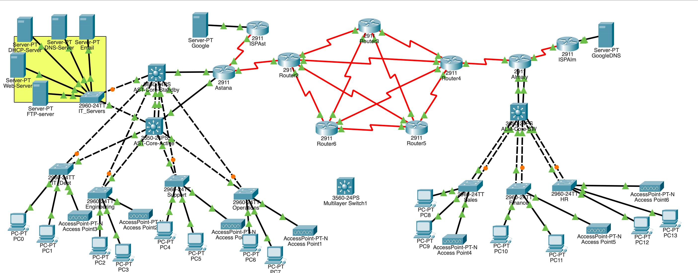

# Multi-Site Enterprise Network Infrastructure Simulation (Astana – Almaty)

## 📌 Project Overview
This project presents the design and configuration of a resilient, highly available, and secure multi-site enterprise network infrastructure connecting corporate branch offices in **Astana** and **Almaty**. 

Built and simulated in **Cisco Packet Tracer**, the network incorporates hierarchical LAN design, dynamic WAN routing, gateway redundancy, bandwidth aggregation, and switch-level security controls.

---

## 🛠️ Key Technical Features

### 🌐 Network Topology & WAN Architecture
* **Hierarchical Star Topology:** Implemented in both branch offices to isolate departmental traffic and streamline switch management.
* **Partial Mesh WAN Backbone:** Interconnects 6 Cisco 2911 WAN routers with redundant links to prevent single points of failure.
* **Dynamic Routing (OSPF Area 0):** Configured across the WAN backbone for fast convergence and dynamic path selection.

### 🔄 Redundancy & High Availability
* **HSRP (Hot Standby Router Protocol):** Active/Standby gateway redundancy running on dual Cisco 3650 Layer 3 switches in Astana (`AST-Core-Active` and `AST-Core-Standby`).
* **EtherChannel:** Link aggregation grouping physical connections between core switches for higher bandwidth and fault tolerance.
* **Rapid PVST+:** Enabled on all switches for sub-second loop prevention and fast topology recalculation.

### 🔒 Network Security & Access Control
* **VLAN Segmentation:** Departmental traffic isolation across VLANs (IT, Engineering, Support, Operations, Sales, Finance, HR, Management, and IT_Servers).
* **Access Control Lists (ACLs):** Configured on edge routers and core switches to restrict unauthorized inter-VLAN and remote management access.
* **Port Security:** Configured in `restrict` mode on Layer 2 access switches with sticky/limited MAC entries; unused ports are shut down.
* **Encrypted Remote Administration:** Disabled Telnet; enforced **SSH v2** with strong secret passwords and local authentication.
* **NAT Overload (PAT):** Allows internal private subnets to reach external services via public IP addresses.

---

## 📊 IP Addressing Scheme (VLSM Summary)
* **Internal LANs:** `172.16.10.0/23` (Subnetted using Variable Length Subnet Masking per department requirement).
* **WAN Links:** `10.10.22.0/24` (Point-to-point `/30` subnets to eliminate IP address waste).
* **Public WAN / ISP:** `85.22.10.0/24` for ISP uplinks and Simulated Google DNS (`8.8.8.0/24`).

---

## 📁 Repository Structure
├── Enterprise_Network_Astana_Almaty.pkt  # Cisco Packet Tracer topology file
├── Reflective_Report.pdf                 # Comprehensive technical design report
├── topology.png                          # Network topology diagram
└── README.md                             # Project documentation

---

## 🚀 How to Run and Test
1. Download and install **Cisco Packet Tracer** (v8.0 or higher).
2. Clone or download this repository.
3. Open `Enterprise_Network_Astana_Almaty.pkt`.
4. **Testing Verification:**
   * **Ping Tests:** Ping between Astana PCs and Almaty PCs across departments.
   * **Redundancy Test:** Shut down the active core switch link in Astana or a primary WAN link to observe automatic HSRP/OSPF failover via `traceroute`.
   * **Web & Email Services:** Open the browser on any PC and navigate to `https://zhcorp.kz` or test DNS resolution to `https://google.com`.
   * **SSH Remote Access:** Attempt SSH connection: `ssh -l zhanel 172.16.11.254`.
